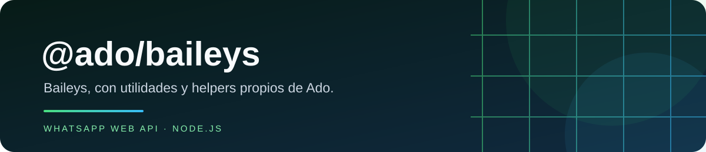

<div align="center">

<picture>
  
</picture>

<br>

[](#requisitos)
[](#licencia)
[](https://github.com/SergioOficial/ado-baileys/actions/workflows/test.yml)

**Una base ligera para trabajar con WhatsApp Web desde Node.js.**

Conserva la API de Baileys y añade helpers de Ado para botones interactivos y stickers.

[Instalación](#instalacion) · [Uso rápido](#uso-rapido) · [Helpers](#helpers-de-ado) · [Sesiones](#sesiones) · [Contribuir](#contribuir) · [Licencia](#licencia)

</div>

<picture>
  
</picture>

## ✨ Qué incluye

| Característica | Descripción |
|---|---|
| 🧩 **API de Baileys** | Mantiene disponibles las exportaciones de `@whiskeysockets/baileys`. |
| 🔘 **Botones interactivos** | Helper `sendInteractiveButtons()` para enviar botones nativos. |
| 🎨 **Stickers** | Helper `sendModdedSticker()` para reenviar stickers conservando sus metadatos. |
| 🔐 **Autenticación persistente** | Compatible con `useMultiFileAuthState()` y guardado de credenciales. |
| 🛠️ **CommonJS** | Uso directo con `require()`. |

<picture>
  
</picture>

## ⚡ Requisitos

- Node.js **20 o superior**.
- npm.
- Una sesión de WhatsApp persistida para evitar vincular el dispositivo en cada inicio.

## 📦 Instalación

Desde npm:

```bash
npm install @ado/baileys
```

O directamente desde GitHub:

```bash
npm install github:SergioOficial/ado-baileys
```

<picture>
  
</picture>

## 🚀 Uso rápido

Este ejemplo crea una conexión, guarda las credenciales y escucha los mensajes entrantes:

```js
const {
  default: makeWASocket,
  useMultiFileAuthState,
  DisconnectReason
} = require('@ado/baileys');

async function start() {
  const { state, saveCreds } = await useMultiFileAuthState('./session');
  const sock = makeWASocket({ auth: state });

  sock.ev.on('creds.update', saveCreds);

  sock.ev.on('connection.update', ({ connection, lastDisconnect }) => {
    if (connection === 'close') {
      const statusCode = lastDisconnect?.error?.output?.statusCode;

      if (statusCode !== DisconnectReason.loggedOut) {
        // Implementa aquí tu estrategia de reconexión.
      }
    }

    if (connection === 'open') {
      console.log('WhatsApp conectado');
    }
  });

  sock.ev.on('messages.upsert', async ({ messages }) => {
    const message = messages?.[0];
    if (!message?.message) return;

    console.log('Mensaje recibido:', message.key);
    // await sock.sendMessage(message.key.remoteJid, { text: '¡Hola!' });
  });
}

start().catch(console.error);
```

> [!WARNING]
> Mantén `./session` fuera del control de versiones. Nunca publiques credenciales, códigos de vinculación ni archivos de sesión.

<picture>
  
</picture>

## 🧰 Helpers de Ado

El paquete conserva las exportaciones de Baileys y añade dos utilidades propias.

### 🔘 Botones interactivos

`sendInteractiveButtons(sock, jid, options)`

```js
const { sendInteractiveButtons } = require('@ado/baileys');

await sendInteractiveButtons(sock, '1234567890@s.whatsapp.net', {
  title: 'Menú',
  text: 'Selecciona una opción',
  footer: 'Ado',
  buttons: [
    {
      name: 'quick_reply',
      buttonParamsJson: {
        display_text: 'Saludar',
        id: 'saludar'
      }
    }
  ]
});
```

- `sock`: socket de Baileys conectado.
- `jid`: identificador del chat o grupo.
- `buttons`: arreglo de botones con `name` y `buttonParamsJson`.

La compatibilidad visual de los botones depende de la versión de WhatsApp y puede cambiar sin aviso.

### 🎨 Stickers

`sendModdedSticker(sock, jid, originalSticker)`

```js
const { sendModdedSticker } = require('@ado/baileys');

// originalSticker debe ser el objeto stickerMessage de un mensaje recibido.
await sendModdedSticker(sock, '1234567890@s.whatsapp.net', originalSticker);
```

La función conserva los metadatos del sticker original y devuelve el resultado de `sock.sendMessage()`.

<picture>
  
</picture>

## 🖼️ Utilidades multimedia

Para descargar contenido multimedia puedes utilizar `downloadContentFromMessage`, exportada por Baileys:

```js
const { downloadContentFromMessage } = require('@ado/baileys');

// const stream = await downloadContentFromMessage(message, 'image');
// Convierte el stream a Buffer si necesitas guardar el archivo.
```

Consulta la documentación de Baileys para conocer los tipos de contenido y el flujo completo de descarga.

<picture>
  
</picture>

## 🔐 Sesiones y autenticación

Guarda las credenciales en una carpeta persistente:

```js
const { state, saveCreds } = await useMultiFileAuthState('./session');
sock.ev.on('creds.update', saveCreds);
```

- Conserva la carpeta entre reinicios.
- No la subas a GitHub ni la compartas.
- Si pierdes las credenciales, tendrás que volver a vincular el dispositivo.

<picture>
  
</picture>

## 🧯 Solución de problemas

<details>
<summary><strong>Cannot find module / error de sintaxis</strong></summary>

- Comprueba que instalaste `@ado/baileys`.
- Verifica que utilizas Node.js 20 o superior.
- Este paquete utiliza CommonJS (`require`).

</details>

<details>
<summary><strong>Se pierden las credenciales</strong></summary>

- Registra `sock.ev.on('creds.update', saveCreds)`.
- Comprueba que `./session` exista y tenga permisos de escritura.
- Asegúrate de que el hosting conserve esa carpeta entre reinicios.

</details>

<details>
<summary><strong>La conexión se cierra</strong></summary>

- Comprueba el código de desconexión.
- Si no fue un cierre de sesión (`DisconnectReason.loggedOut`), aplica una reconexión controlada.
- Evita crear conexiones repetidas sin cerrar correctamente las anteriores.

</details>

<picture>
  
</picture>

## 🤝 Contribuir

¡Las mejoras son bienvenidas!

1. Haz un fork del repositorio.
2. Crea una rama: `feat/mi-mejora`.
3. Realiza los cambios y ejecuta las pruebas.
4. Abre un Pull Request explicando qué cambiaste.

<picture>
  
</picture>

## 📄 Licencia

Este proyecto se distribuye bajo la licencia **MIT**. Consulta el archivo [LICENSE](LICENSE) y las licencias de las dependencias utilizadas.

<div align="center">

⭐ Si te resulta útil, considera darle una estrella al repositorio.

Hecho con 💚 por [SergioOficial](https://github.com/SergioOficial)

[Repositorio](https://github.com/SergioOficial/ado-baileys) · [Reportar un problema](https://github.com/SergioOficial/ado-baileys/issues)

</div>
